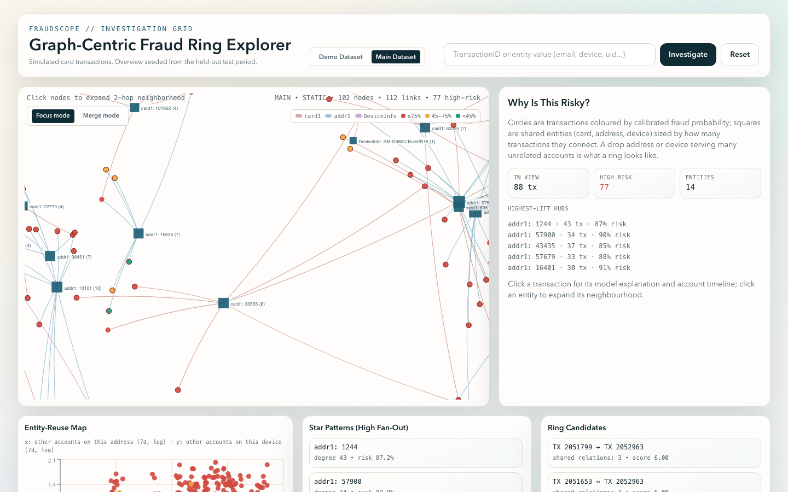

# FraudScope

Fraud-ring detection on simulated card transactions: graph features built only from past data, an XGBoost model, and a graph explorer for looking into flagged transactions.

**Demo:** [fraudscope.vercel.app](https://fraudscope.vercel.app)



The simulator (`src/fraud_graphs/synthetic_v2.py`) creates customers and households that legitimately share cards and devices. It adds fraud rings that reuse stolen cards, devices and addresses, plus card testing, account takeover and first-party fraud. It records each transaction's true fraud probability, which gives a ceiling for any model.

The graph features (`graph_features.py`) look only at earlier transactions:
- how many other accounts used the same card, address or device in the last hour, day and week;
- that entity's fraud rate, using only labels at least 14 days old, to allow for chargeback delay;
- a two-hop count of addresses reachable through devices seen with the card.

`tests/test_no_lookahead.py` checks that changing future rows doesn't change these features or the account score blend.

## Results

PR-AUC on the last 15% of the timeline, mean ± sd over 5 simulator seeds ([per-seed results](results/ablation_pr_auc.csv)):

| Features | PR-AUC |
|---|---|
| True probabilities (ceiling) | 0.61 ± 0.06 |
| Transaction fields only | 0.53 ± 0.08 |
| All features, including graph | 0.58 ± 0.06 |
| Graph features only | 0.54 ± 0.07 |

Adding the graph features raises PR-AUC by 0.04 on average over transaction fields alone, within each seed (range +0.01 to +0.07), reaching about 94% of the ceiling. Per-account averages fitted on the training window make things worse (0.34), because they don't carry over to new time periods.

All of this is on simulated data where the simulator plants the patterns the graph features look for. It shows the features work when rings behave this way, not how much they would add on a real portfolio.

## Running it

```bash
pip install -r requirements.txt
pytest
python scripts/build_backend_api_artifacts.py       # simulate, train, score (~1.5 min)
python scripts/verify_generator_v2.py --quick       # the ablation above, one seed
python scripts/export_frontend_snapshots.py --artifacts-dir outputs/backend_api/artifacts --out-dir frontend/public/snapshots
cd frontend && npm ci && npm run dev
```

The frontend reads the exported JSON snapshots. `python scripts/run_api.py --artifacts-dir outputs/backend_api/artifacts` serves the same data from a FastAPI backend; start the frontend with `NEXT_PUBLIC_DATA_SOURCE=api` to use it.

The account-ID idea comes from Chris Deotte's and Konstantin Yakovlev's IEEE-CIS Kaggle work, and the simulator's column layout follows that dataset.
